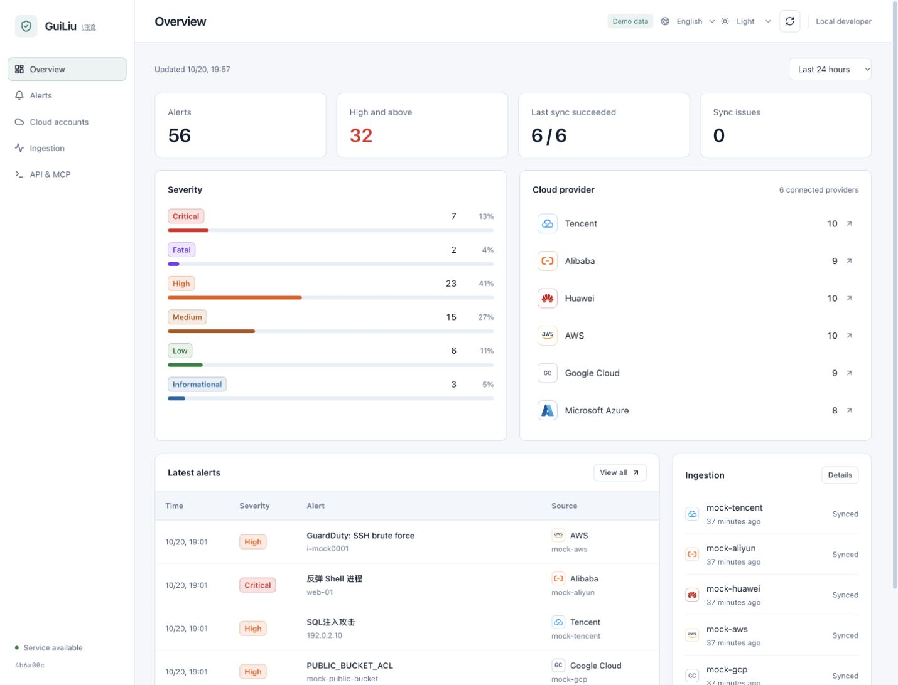

<picture>
  <source media="(prefers-color-scheme: dark)" srcset="web/public/brand/logo-dark.svg">
  
</picture>

**Open-source Security Data Access Layer. Unified security data, independent conclusions.**

[English](README.md) · [简体中文](README.zh-CN.md)

The project remains in `0.x` development; `1.0` has not been released. See the [current version](internal/version/VERSION), [changelog](CHANGELOG.md) and [versioning policy](docs/versioning.md).

GuiLiu collects alerts from cloud security services, normalizes them into a shared fact contract with source-appropriate OCSF projections, and preserves the original vendor payload. Security teams and their own agents query the same data through a web console, REST API, read-only MCP tools, or a read-only query CLI.

Built by [BaiLi Labs](https://github.com/BaiLi-Labs). Self-hosted, with a single Go binary and an embedded web console.



## Why GuiLiu

Working across clouds means maintaining separate credentials, queries, severity scales, and evidence formats. An agent needs those integrations just as much as an analyst does.

GuiLiu provides a common data layer:

- **Reliable ingestion.** Incremental windows, rate limits, retries, and page-level checkpoints. Failed mappings retain their raw payload separately and are retried without blocking newer alerts.
- **Consistent queries.** A shared fact contract for source severity/status, accounts, assets, IPs, hashes, users and evidence. OCSF classification follows source semantics; missing facts remain unknown.
- **Original data.** Vendor JSON and mapping versions remain available alongside normalized fields. Query-time grouping preserves the underlying alerts.
- **Human and agent access.** One dataset across the console, REST API, 20 read-only MCP tools, and a read-only query CLI for shell agents and automation. Bring your own agent.

A typical workflow: connect cloud accounts, filter or group alerts, inspect the original data, then let your existing agent query the same records through MCP or the query CLI. Analysis and response stay with the tools you choose.

See the [data access contract](docs/security-data-access.md) for persistent change feeds, pinned query snapshots, field provenance, full revision pagination and machine-readable coverage. Development schema 5 requires a new database; existing databases are rejected without being erased.

The first asset adapters cover six clouds: Tencent CVM, Alibaba ECS, Huawei ECS, AWS EC2, GCP Compute and Azure VM. They provide instance metadata, OS, IPs, VPC/subnet/security-group references and tags, with scoped references to independent security groups, VPCs and subnets. Follow those references to query names, CIDRs, tags, source policy evidence and revisions. Reads use saved local observations; administrators can explicitly refresh an instance or one network resource. Source capabilities are kept apart: GCP does not treat firewalls as instance security groups, Huawei does not invent a subnet ID, and Azure follows only the NICs explicitly referenced by the VM. All six have synthetic-response and contract validation only and await per-account verification. Software, listening ports, and reachability observations are not collected. See the [asset contract](docs/security-data-access.md#资产上下文首版).

Web, REST and MCP access is recorded in a persistent audit with user/API key identity, query scope, result references and timing. Administrators can trace related calls in **Access audit**. Credentials and raw evidence bodies are excluded; retention defaults to 90 days. See the [audit contract](docs/access-audit.md).

## Connector coverage

Each connector targets a specific cloud security API. Other products are visible only when their alerts are included by that upstream service.

| Cloud           | Upstream service                         | Validation                                                                      |
| --------------- | ---------------------------------------- | ------------------------------------------------------------------------------- |
| Tencent Cloud   | CSIP · `DescribeAlertList`               | Tested with a real account: backfill, incremental sync, throttling, and resume  |
| Alibaba Cloud   | SAS · `DescribeSuspEvents`               | Implemented; unit tests and synthetic fixtures; real-account validation pending |
| Huawei Cloud    | SecMaster · `ListAlerts`                 | Implemented; unit tests and synthetic fixtures; real-account validation pending |
| AWS             | Security Hub · `GetFindingsV2`           | Implemented; unit tests and synthetic fixtures; real-account validation pending |
| Google Cloud    | Security Command Center · `ListFindings` | Implemented; unit tests and synthetic fixtures; real-account validation pending |
| Microsoft Azure | Defender for Cloud · `Alerts - List`     | Implemented; unit tests and synthetic fixtures; real-account validation pending |

The console supports English and Simplified Chinese, remembers language and appearance preferences, and formats dates and numbers for the selected language. Vendor alert content remains in its original language.

## Try it locally

Requirements: Go 1.26+, Node.js 20+, and npm.

```bash
make mock
```

Open <http://127.0.0.1:8081>. The demo contains 56 synthetic alerts across six providers, uses an in-memory database, and disables authentication and scheduled ingestion. It does not require cloud credentials.

## Deploy

Build the embedded console and server:

```bash
make build
cp configs/guiliu.example.json guiliu.json
export GUILIU_ADMIN_PASSWORD='replace-with-a-long-initial-password'
./bin/guiliu serve
```

Open <http://127.0.0.1:8080>, sign in as `admin`, and connect an account from **Cloud accounts**. Use read-only cloud permissions.

For Docker:

```bash
docker build -t guiliu:dev .
docker run --rm -p 127.0.0.1:8080:8080 \
  -v "$PWD/data:/data" \
  -e GUILIU_ADMIN_PASSWORD='replace-with-a-long-initial-password' \
  guiliu:dev
```

The current storage implementation is single-instance SQLite. Preserve the database and encryption key together when backing up. For remote access, configure an HTTPS reverse proxy and secure cookies; see the [deployment and operations guide](docs/development.md).

## Connect your agent

In **API & MCP**, create an API key and copy the HTTP configuration into your MCP client:

```json
{
  "mcpServers": {
    "guiliu": {
      "type": "http",
      "url": "http://127.0.0.1:8080/mcp",
      "headers": {
        "Authorization": "Bearer <API_KEY>"
      }
    }
  }
}
```

| Task                           | MCP tools                                                             |
| ------------------------------ | --------------------------------------------------------------------- |
| Query alerts                   | `list_alerts`, `search_alerts_by_ip`, `search_alerts_by_asset`        |
| Group and expand               | `list_alert_groups`, `get_alert_group`                                |
| Inspect evidence               | `get_alert`, `get_alert_evidence`                                     |
| Investigate assets and networks | `get_alert_asset_context`, `get_asset_by_reference`, `get_asset_component`, `list_asset_findings` |
| Inspect coverage and ingestion | `list_cloud_accounts`, `get_alert_statistics`, `get_connector_health` |

For example, ask your agent to find high-severity alerts from the last 24 hours, group by type and asset, then expand the original alerts and cite their IDs. Groups match exact field values; counts are alert records, and maximum severity comes from the vendor-mapped member levels. Grouping makes no false-positive judgments. Check ingestion progress before interpreting an empty result.

MCP tools are read-only, with limits of 200 records per call and a 90-day query window. Alert lists default to the last seven days and include account ingestion status. API keys inherit their owner's role and access all cloud accounts in the instance. REST endpoint details and stdio setup are in the [API and MCP guide](docs/development.md).

### CLI and skill

The same binary includes a read-only query client over the REST API for shell
agents, CI, batch exports and pagination. It does not need an MCP client and
does not read the database directly:

```bash
export GUILIU_URL="http://127.0.0.1:8080"
export GUILIU_API_KEY="glk_..."

guiliu query describe
guiliu query alerts --since 24h --severity high,critical --limit 20 --json
guiliu query alerts --since 7d --all --max-items 500 --ndjson | jq -c '{id,severity,title}'
guiliu query changes --cursor 12345 --limit 100 --json
guiliu query coverage --since 7d --json
```

Output is a human table by default, `--json` is the exact REST body for one
page, and `--ndjson` emits one record per line for `--all` batches. Metadata
and coverage warnings go to stderr. `guiliu query describe` is the
machine-readable source of truth for commands, flags and limits. The companion
agent skill lives in [`skills/guiliu-query/SKILL.md`](skills/guiliu-query/SKILL.md).
CLI calls carry `X-Guiliu-Client: cli`, so the access audit records
`surface=cli`.

## Security and deployment boundaries

- Local users with `admin` and `viewer` roles; authenticated access is required by default.
- Argon2id password hashes, HttpOnly session cookies, and revocable API keys stored as hashes.
- Cloud credentials encrypted at rest with AES-256-GCM.
- Platform alert status is independent of vendor status. GuiLiu does not write changes back to cloud services.
- A shared dataset within each instance. OIDC, tenant isolation, and fine-grained API-key scopes are not implemented.
- Replay historical mappings offline with `guiliu replay`. It previews changes by default; use `-apply` to write them.

See the [current limitations and validation record](docs/development.md) before connecting a production workload. OCSF schema validation in CI, additional storage backends, and broader real-account validation remain on the roadmap.

## Architecture

Connectors fetch and normalize vendor alerts. The ingestion engine manages checkpoints and retries. A shared store serves REST, MCP, the query CLI, and the console.

Go · React · TypeScript · Tailwind CSS · SQLite · OCSF 1.6

The `store.Store` interface separates storage from ingestion and query handlers. PostgreSQL and ClickHouse are potential future implementations, not currently shipped backends.

## Development

```bash
make test                          # Go tests
make vet                           # Go static checks
npm --prefix web test              # Locale, routing, and UI regression checks
npm --prefix web run build         # TypeScript checks and production console build
```

- [Development and operations](docs/development.md) — configuration, API, deployment, and validation records; currently in Chinese.
- [Connector guide](docs/connector-guide.md) — add a provider, implement mapping, and classify failures.
- [Fixture guide](internal/mock/README.md) — synthetic samples and redaction rules.

Issues with reproducible samples and connector contributions are welcome. Remove credentials and sensitive customer data before sharing payloads.

## License

[Apache License 2.0](LICENSE). See [NOTICE](NOTICE) for attribution.

Cloud-provider names and trademarks belong to their respective owners. Embedded brand icons use [theSVG](https://github.com/glincker/thesvg) and [Devicon](https://github.com/devicons/devicon), both under the MIT license.
