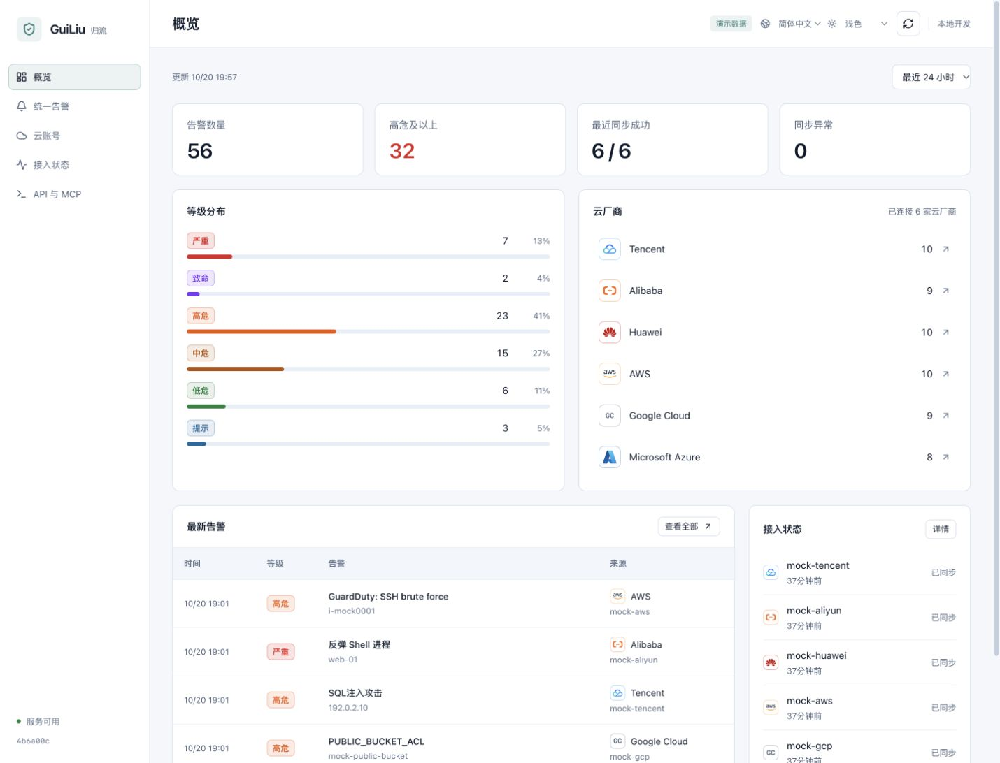

<picture>
  <source media="(prefers-color-scheme: dark)" srcset="web/public/brand/logo-dark.svg">
  
</picture>

**开源安全数据访问层。统一安全数据，不统一安全结论。**

[English](README.md) · [简体中文](README.zh-CN.md)

当前处于 `0.x` 开发阶段，尚未发布 `1.0`。查看[当前版本](internal/version/VERSION)、[更新日志](CHANGELOG.md)与[版本管理约定](docs/versioning.md)。

归流接入分散在各云安全产品中的告警，统一字段、保留厂商原始数据，并通过控制台、REST API 和只读 MCP 提供一致的数据访问。安全团队和企业自己的 Agent 使用同一份数据。

由 [BaiLi Labs](https://github.com/BaiLi-Labs) 开发，支持自托管。控制台随 Go 服务打包为单个二进制。



## 为什么使用归流

多云环境需要分别维护凭据、查询方式、告警等级和证据格式。人工分析和 Agent 接入都需要重复解决这些问题。

归流提供一层公共的数据基础设施：

- **可靠接入**：增量窗口、限流重试、页级断点续传。映射失败的原始载荷独立保存并自动重试，不阻塞后续采集。
- **统一查询**：账号、来源等级与状态、资产、IP、Hash、用户和证据使用同一套事实契约；OCSF 按来源语义投影，不推造缺失字段。
- **保留原始数据**：统一字段之外，可查看厂商原始 JSON 和映射版本；查询时分组保留全部原始告警。
- **人和 Agent 共用**：控制台、REST API、20 个只读 MCP 工具访问同一份数据，可接入企业现有 Agent。

一次典型使用流程：接入云账号，筛选或分组告警，检查原始数据，再让已有 Agent 通过 MCP 查询相同记录。研判与响应由团队选择的工具完成。

详见[安全数据访问契约](docs/security-data-access.md)：持久 Change Feed、固定查询快照、字段溯源、完整修订分页与机器可读覆盖范围。开发阶段 schema 5 不迁移旧数据库，请使用新数据库文件；服务不会自动清空旧数据。

资产首版提供腾讯云 CVM 的实例、操作系统、IP 和标签，并通过完整作用域引用关联独立的安全组、VPC 与子网，可继续查询名称、CIDR、标签、策略原始证据和修订。普通查询只读本地观测，管理员可显式刷新指定实例或单个网络资源。该新增能力目前仅通过合成响应验证，待真实账号验证；不提供软件、监听端口或可达性观测。详见[资产访问契约](docs/security-data-access.md#资产上下文首版)。

Web、REST 与 MCP 的查询和操作写入独立的持久审计，记录用户/API Key 身份、查询范围、结果引用及耗时，管理员可在“操作审计”页追溯同一请求。审计不保存凭据或原始证据正文，默认保留 90 天。详见[操作审计说明](docs/access-audit.md)。

产品长期边界与当前交付范围见[产品方向与设计约束](docs/product-direction.md)。

## 接入范围

连接器针对特定云安全 API。云厂商旗下其他产品的告警，取决于上游服务是否已经汇入对应数据。

| 云厂商          | 上游服务                                 | 验证状态                                       |
| --------------- | ---------------------------------------- | ---------------------------------------------- |
| 腾讯云          | CSIP · `DescribeAlertList`               | 已用真实账号验证回填、增量同步、限流和断点续传 |
| 阿里云          | SAS · `DescribeSuspEvents`               | 已实现，含单元测试与合成样本；待真实账号验证   |
| 华为云          | SecMaster · `ListAlerts`                 | 已实现，含单元测试与合成样本；待真实账号验证   |
| AWS             | Security Hub · `GetFindingsV2`           | 已实现，含单元测试与合成样本；待真实账号验证   |
| Google Cloud    | Security Command Center · `ListFindings` | 已实现，含单元测试与合成样本；待真实账号验证   |
| Microsoft Azure | Defender for Cloud · `Alerts - List`     | 已实现，含单元测试与合成样本；待真实账号验证   |

控制台支持简体中文和英文，记住语言与外观设置，日期和数字随语言切换。厂商告警正文与原始证据保留原文。

## 本地体验

环境要求：Go 1.26+、Node.js 20+、npm。

```bash
make mock
```

打开 <http://127.0.0.1:8081>。演示包含六家云的 56 条合成告警，使用内存数据库，关闭认证与定时采集，无需云账号凭据。

## 部署

构建控制台与服务：

```bash
make build
cp configs/guiliu.example.json guiliu.json
export GUILIU_ADMIN_PASSWORD='replace-with-a-long-initial-password'
./bin/guiliu serve
```

打开 <http://127.0.0.1:8080>，使用 `admin` 登录，在「云账号」中添加接入。云凭据应仅授予告警读取权限。

Docker 部署：

```bash
docker build -t guiliu:dev .
docker run --rm -p 127.0.0.1:8080:8080 \
  -v "$PWD/data:/data" \
  -e GUILIU_ADMIN_PASSWORD='replace-with-a-long-initial-password' \
  guiliu:dev
```

当前提供单实例 SQLite 存储。备份时需要同时保留数据库与加密主密钥。远程访问应配置 HTTPS 反向代理与安全 Cookie，详见[部署与运维文档](docs/development.md)。

## 接入 Agent

进入「API 与 MCP」，创建 API Key，将 HTTP 配置加入 MCP 客户端：

```json
{
  "mcpServers": {
    "guiliu": {
      "type": "http",
      "url": "http://127.0.0.1:8080/mcp",
      "headers": {
        "Authorization": "Bearer <API_KEY>"
      }
    }
  }
}
```

| 任务           | MCP 工具                                                              |
| -------------- | --------------------------------------------------------------------- |
| 查询告警       | `list_alerts`、`search_alerts_by_ip`、`search_alerts_by_asset`        |
| 资产与网络调查 | `get_alert_asset_context`、`get_asset_by_reference`、`get_asset_component`、`list_asset_findings` |
| 分组与展开     | `list_alert_groups`、`get_alert_group`                                |
| 检查证据       | `get_alert`、`get_alert_evidence`                                     |
| 检查接入与采集 | `list_cloud_accounts`、`get_alert_statistics`、`get_connector_health` |

例如，让 Agent 检索过去 24 小时的高危告警，按类型与资产查看分组，再展开原始告警并引用 ID。分组只按字段原值匹配，条数是告警记录数，组内最高等级取自厂商告警；不判断误报。判断「没有告警」前，应先检查数据采集进度。

MCP 工具只读，单次最多返回 200 条，查询时间范围最多 90 天；告警列表默认查询最近 7 天，结果附带账号采集状态。API Key 继承创建者的角色权限，可访问本实例全部云账号。REST 接口及 stdio 配置见 [API 与 MCP 文档](docs/development.md)。

## 安全与部署边界

- 默认必须认证，支持本地用户与 `admin` / `viewer` 两种角色。
- Argon2id 密码哈希、HttpOnly Session Cookie；API Key 支持吊销，服务端仅保存哈希。
- 云凭据使用 AES-256-GCM 加密存储。
- 平台告警状态与厂商状态独立，不向云厂商写回修改。
- 每个实例使用共享数据集，尚未实现 OIDC、租户隔离和细粒度 API Key 授权。
- 保留原始载荷，支持通过 `guiliu replay` 离线重映射历史数据，默认预览，添加 `-apply` 才写入。

接入正式环境前，请阅读[已知限制与验证记录](docs/development.md)。OCSF Schema 的 CI 校验、其他存储后端，以及更多厂商的真实账号验证仍在路线图中。

## 架构

连接器负责读取和归一化厂商告警；同步引擎管理断点、重试与游标；统一存储为控制台、REST API 与 MCP 提供查询。

Go · React · TypeScript · Tailwind CSS · SQLite · OCSF 1.6

`store.Store` 接口隔离存储、采集与查询逻辑。PostgreSQL、ClickHouse 为未来可扩展方向，当前并未提供对应实现。

## 开发

```bash
make test                          # Go 测试
make vet                           # Go 静态检查
npm --prefix web test              # 国际化、路由与界面回归检查
npm --prefix web run build         # TypeScript 检查与控制台构建
```

- [开发与运维](docs/development.md)：配置、API、部署、验证记录。
- [连接器开发指南](docs/connector-guide.md)：新增厂商、实现映射、错误分类。
- [样本说明](internal/mock/README.md)：合成数据、脱敏规则。

欢迎提交可复现的问题和连接器改进。分享样本前请移除凭据及客户敏感信息。

## 许可证

[Apache License 2.0](LICENSE)，归属声明见 [NOTICE](NOTICE)。

云厂商名称与商标归各自所有者所有。内置品牌图标来自 [theSVG](https://github.com/glincker/thesvg) 与 [Devicon](https://github.com/devicons/devicon)，均为 MIT 许可证。
